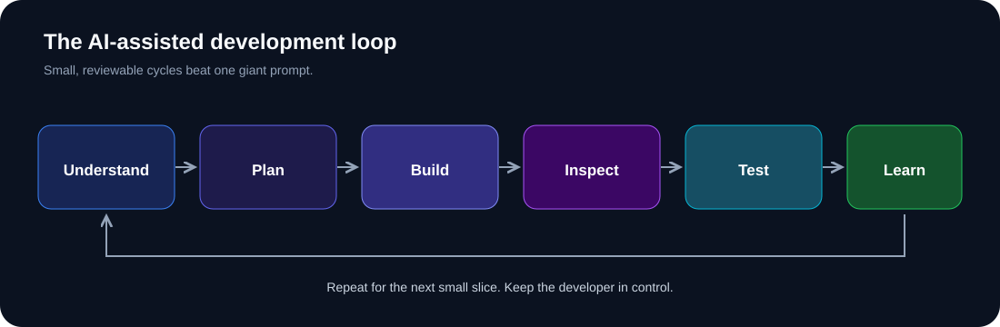

# AI Developer Playbook
### A practical guide to building software effectively with AI.

**Think clearly. Give context. Build in small steps. Verify everything.**

[Learning path](#learning-path) · [Guides](#guides) · [Hands-on lab](labs/task-api-lab.md) · [Contributing](CONTRIBUTING.md)

## What you'll learn

AI coding tools can accelerate development. They can also produce plausible bugs, insecure code, unnecessary complexity, and features you never asked for. This playbook teaches repeatable engineering habits—not magic prompts.

- Turn a vague idea into testable requirements.
- Give an AI assistant relevant project context.
- Generate and review small, understandable changes.
- Debug using evidence instead of random retries.
- Test, secure, and deploy applications responsibly.
- Supervise coding agents and understand the harness around them.

## The development loop

The loop is: **understand → plan → build → inspect → test → learn**. Repeat it for each small slice.

## Learning path

| Stage | Read | Outcome |
|---|---|---|
| 1. Foundations | [30 core rules](principles/core-rules.md), [developer responsibility](principles/developer-responsibility.md) | Know what AI should and should not own |
| 2. Prompting | [Prompt fundamentals](prompting/prompt-fundamentals.md), [templates](prompting/prompt-templates.md) | Write a testable coding request |
| 3. Context | [Context engineering](prompting/context-engineering.md) | Supply relevant project knowledge |
| 4. Building | [Planning](application-building/planning.md), [end-to-end workflow](application-building/application-workflow.md) | Break an app into reviewable slices |
| 5. Verification | [Debugging and testing](application-building/debugging-and-testing.md) | Reproduce, isolate, fix, and retest |
| 6. Agents | [Agent workflows](ai-agents/agent-workflows.md), [harness engineering](ai-agents/harness-engineering.md) | Supervise multi-step coding agents |
| 7. Shipping | [Security review](checklists/security-review.md), [release checklist](checklists/before-deployment.md) | Review before users depend on it |

## Guides

### Principles
- [30 rules for AI-assisted development](principles/core-rules.md)
- [30 practical vibe-coding rules](principles/vibe-coding-rules.md)
- [Developer responsibility](principles/developer-responsibility.md)

### Prompting and context
- [Prompt engineering fundamentals](prompting/prompt-fundamentals.md)
- [Context engineering](prompting/context-engineering.md)
- [Copy-ready prompt templates](prompting/prompt-templates.md)

### Application building
- [Plan before you build](application-building/planning.md)
- [End-to-end application workflow](application-building/application-workflow.md)
- [Debugging and testing](application-building/debugging-and-testing.md)

### Agents and checklists
- [Coding agent workflows](ai-agents/agent-workflows.md)
- [Harness engineering](ai-agents/harness-engineering.md)
- [Before coding](checklists/before-coding.md)
- [Security review](checklists/security-review.md)
- [Before deployment](checklists/before-deployment.md)

## Learn by building

Start with the [mini-lab: build a task API with an AI assistant](labs/task-api-lab.md). Practice requirements, planning, one small implementation, testing, and review.

Every guide aims to include **why it matters**, **try it**, **a prompt to use**, **how to check your work**, and **common failure modes**.

## Visual and video learning

The diagrams in [assets/](assets/) are original SVGs stored in this repository. For video-led learning, start with the official [OpenAI Agents learning hub](https://developers.openai.com/learn/agents), which includes video lessons and demos, and the [VS Code context engineering guide](https://code.visualstudio.com/docs/agents/guides/context-engineering-guide).

## Primary references

- [OpenAI prompt engineering](https://developers.openai.com/api/docs/guides/prompt-engineering)
- [OpenAI Agents learning hub](https://developers.openai.com/learn/agents)
- [GitHub Copilot prompting](https://docs.github.com/en/copilot/concepts/prompting-and-context/prompt-engineering)
- [VS Code context engineering](https://code.visualstudio.com/docs/agents/guides/context-engineering-guide)
- [Anthropic: Effective harnesses for long-running agents](https://www.anthropic.com/research/effective-harnesses-for-long-running-agents)
- [OWASP Top 10 for LLM Applications](https://owasp.org/www-project-top-10-for-large-language-model-applications/)

## Who is this for?

Developers, students, indie builders, and teams using AI assistants or coding agents. No specific model, IDE, or framework is required.

## Contributing

Found an unclear explanation, outdated link, missing edge case, or useful exercise? See [CONTRIBUTING.md](CONTRIBUTING.md).

## License

MIT. See [LICENSE](LICENSE).

**Build with AI. Think like an engineer. Verify like it matters.**

