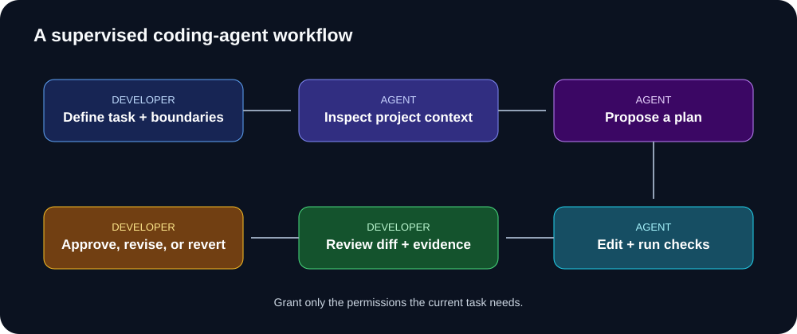

# Working with AI coding agents

A coding agent may inspect files, edit code, run commands, and use tools. That capability makes boundaries, observability, and approvals more important.



## Good starter tasks
- Explain a module or trace a request path.
- Draft tests for a clearly defined behavior.
- Update docs from verified code.
- Make a small isolated refactor.
- Investigate a reproducible bug.

Use extra caution with authentication, payments, personal data, production infrastructure, destructive commands, bulk edits, and dependency upgrades.

## Define the operating contract
1. Outcome and scope.
2. Files or areas in scope.
3. What must not change.
4. Commands the agent may run.
5. Actions requiring approval.
6. Tests and acceptance criteria.
7. Expected final report.

## Example task contract

```text
Task: Add pagination to GET /api/tasks.
Inspect the route, query layer, and tests first.
Do not change schema or unrelated endpoints.
Do not run destructive commands or access production data.
Ask before adding dependencies.

Acceptance:
- Stable ordering is defined.
- Invalid page/limit values are handled.
- A user sees only their own tasks.
- Tests cover empty, first, and later pages.

Finish with a diff summary, test commands and actual results,
and unresolved concerns.
```

## Human approval checkpoints

Require approval before deleting data, running shared-environment migrations, changing permissions or secrets, deploying, sending external messages, or expanding scope.

## Further learning
- [OpenAI Agents learning hub](https://developers.openai.com/learn/agents)
- [OpenAI building agents guide](https://developers.openai.com/api/docs/guides/agents)
- [GitHub Copilot prompting](https://docs.github.com/en/copilot/concepts/prompting-and-context/prompt-engineering)
