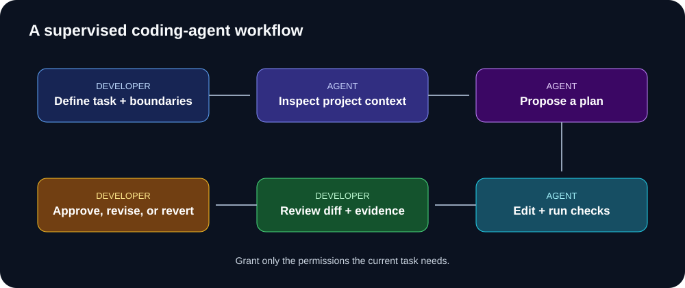

# Plan before you build

A useful plan is small enough to review and detailed enough to reveal missing decisions.

## 1. Define the product slice
- **User:** Who is this for?
- **Problem:** What are they trying to do?
- **Outcome:** What should happen?
- **Non-goals:** What is excluded?
- **Constraints:** Stack, time, budget, data, accessibility.

## 2. Write testable acceptance criteria

Weak: “Resume upload should work.”

Better:
- A signed-in user can upload a supported PDF.
- The server checks file type and size before processing.
- An invalid file returns a useful error and is not stored.
- A successful upload returns a processing status.
- A user cannot read another user's file.

Avoid vague words such as “fast” and “secure” unless you define how to measure them.

## 3. Map the system



Identify interface, API, business logic, persistence, external services, and operations. A small app may not need every layer.

## 4. Break work into vertical slices
1. Display the upload form.
2. Validate the file on the server.
3. Store it using private storage rules.
4. Save metadata with ownership.
5. Show processing status.
6. Test invalid files and cross-user access.

A vertical slice delivers a small end-to-end behavior. Avoid asking an agent to build every layer at once.

## 5. Ask AI to challenge the plan

```text
Review this plan for missing requirements, unnecessary complexity,
security risks, data-model problems, and test gaps.
Do not rewrite it yet. List each concern, its impact, and the
question or evidence that would resolve it.

[Paste requirements and plan]
```

## 6. Definition of done
- Acceptance criteria met.
- Relevant tests pass.
- Error and empty states handled.
- Authorization and data handling reviewed.
- Documentation updated where needed.
- Diff reviewed and rollback understood.

## Practice
Choose a feature in a project you know. Write five acceptance criteria and split it into three to six slices. Ask AI to find missing edge cases; decide which suggestions are relevant.
